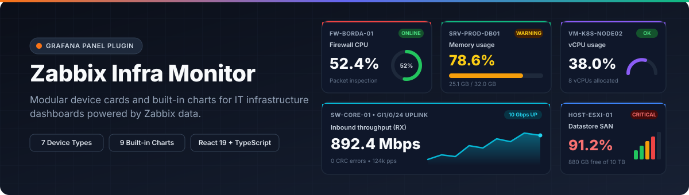
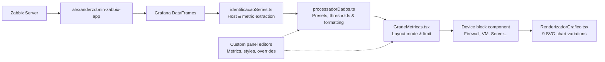

<p align="center">
  
</p>

<p align="center">
  <a href="https://github.com/guilhermeladislau/Dashboards-Grafana-React/actions/workflows/ci.yml"></a>
  = 13.2.0" />
  
  
  
  <a href="./LICENSE"></a>
</p>

<p align="center">
  <strong>English</strong> · <a href="./README.pt-BR.md">Português (Brasil)</a>
</p>

**Zabbix Infra Monitor Panel** (`guilhermeladislau-zabbixmonitor-panel`) is a Grafana panel plugin built with React and TypeScript to display IT infrastructure telemetry from Zabbix (`alexanderzobnin-zabbix-app`). Instead of configuring a separate stat, gauge, or time-series panel for each item, you pick a device profile (Firewall, VM, Hypervisor, Server, Proxy, Access Point, or Switch Port) and the panel groups metrics by host, applies presets for units and thresholds, and renders built-in SVG charts inside each card.

## Highlights

- **7 device profiles** with presets for units, default chart types, icons, and warning/critical thresholds.
- **9 built-in SVG visualizations** per metric block: horizontal progress bar, 360° circular gauge, 180° semi-gauge arc, ring/donut, graduated vertical tower, area sparkline, line sparkline, bullet meter, and vertical thermometer.
- **3 card layout modes**:
  - `individual`: one card per device, grouping all metrics that belong to that device.
  - `consolidado`: all devices and metrics inside a single card (or grouped by metric / by device).
  - `metricas_separadas`: one standalone card per metric in a responsive CSS grid.
- **Series parser tuned for Zabbix**: extracts host and item names from labels (`host`, `hostname`, `device`, `instance`, `item`) or from standard Zabbix naming conventions (`HOST: Metric`, `HOST - Metric`), keeping multiple metrics of the same component (such as `CPU: CPU usage` and `CPU: Number of cores`) under a single card.
- **Granular overrides**: customize chart type, unit, decimals, thresholds, colors, and click-through URLs (`linkUrl`) for individual metrics or specific block indices.

## Screenshots

Save your dashboard captures in [`docs/images/`](./docs/images/) using the filenames below (or update the paths):

| Consolidated multi-device view | Individual device cards & chart types | Panel editor options |
| :---: | :---: | :---: |
| *`docs/images/overview.png`* | *`docs/images/charts.png`* | *`docs/images/editor.png`* |

## How data flows through the panel



1. [`identificacaoSeries.ts`](./src/utilitarios/identificacaoSeries.ts) inspects the whole set of `DataFrame`s returned by the query so it can tell whether a prefix before `: ` is a host name shared across items or part of a metric name.
2. [`processadorDados.ts`](./src/utilitarios/processadorDados.ts) matches each series against the active device catalog in [`preconfiguracoesDispositivos.ts`](./src/utilitarios/preconfiguracoesDispositivos.ts), evaluates normal, inverted, or fixed thresholds, formats values (`bps`, `bytes`, `%`, `ms`, `dBm`, `W`, `°C`, `uptime`, `status`), and applies per-metric or per-block overrides.
3. [`GradeMetricas.tsx`](./src/components/grade/GradeMetricas.tsx) groups items according to `cardDisplayMode` and delegates rendering to either [`BlocoConsolidadoDispositivo.tsx`](./src/components/dispositivos/BlocoConsolidadoDispositivo.tsx) or the device-specific component via [`SeletorBlocoDispositivo.tsx`](./src/components/dispositivos/SeletorBlocoDispositivo.tsx).

## Supported device profiles and presets

| Profile (`deviceType`) | Accent | Preconfigured metrics (`AnyDeviceMetricType`) |
| :--- | :--- | :--- |
| `firewall` | `#ef4444` | Status (`fw_status`), CPU (`fw_cpu`), Memory (`fw_memoria`), Active sessions (`fw_sessoes`), WAN RX/TX (`fw_trafego_wan_in` / `out`), VPN status (`fw_vpn_status`), IPS blocked threats (`fw_ameacas_bloqueadas`), Uptime (`fw_uptime`) |
| `vm` | `#8b5cf6` | Power state (`vm_estado`), vCPU (`vm_cpu_uso`), CPU Ready (`vm_cpu_ready`), RAM (`vm_memoria_uso`), Disk used/free (`vm_disco_usado` / `livre`), Virtual disk IOPS (`vm_iops`), Active snapshots (`vm_snapshots`), vNIC traffic (`vm_rede`), Uptime (`vm_uptime`) |
| `proxy` | `#06b6d4` | Service status (`proxy_status`), Requests/s (`proxy_requisicoes_seg`), Cache hit ratio (`proxy_cache_hit`, inverted threshold), HTTP latency (`proxy_latencia`), Active connections (`proxy_conexoes_ativas`), Bandwidth (`proxy_banda`), CPU (`proxy_cpu`), RAM (`proxy_memoria`), HTTP 4xx/5xx (`proxy_erros_http`) |
| `host` | `#3b82f6` | Host status (`host_status`), Hardware health (`host_saude`), Physical CPU (`host_cpu_uso`), Physical RAM (`host_memoria_uso`), Datastore used/free (`host_datastore_uso` / `livre`), Active VMs (`host_vms_ativas`), Hardware temperature (`host_temperatura`), Power draw (`host_energia`), Uptime (`host_uptime`) |
| `servidor` | `#10b981` | ICMP ping (`srv_status_ping`), Zabbix agent status (`srv_status_agent`), CPU (`srv_cpu_uso`), CPU queue (`srv_cpu_fila`), RAM used/free (`srv_memoria_uso` / `livre`), Disk used/free/latency (`srv_disco_uso` / `livre` / `latencia`), Network traffic (`srv_rede_trafego`), Stopped services (`srv_servicos_parados`), Uptime (`srv_uptime`) |
| `access_point` | `#f59e0b` | AP status (`ap_status`), Connected clients (`ap_clientes`), Signal quality % (`ap_sinal_qualidade`), RSSI in dBm (`ap_sinal_dbm`), Channel interference (`ap_interferencia`), Wi-Fi RX/TX (`ap_trafego_in` / `out`), CPU (`ap_cpu`), Uptime (`ap_uptime`) |
| `porta_rede` | `#ec4899` | Link status UP/DOWN (`porta_status`), RX/TX traffic (`porta_trafego_in` / `out`), Bandwidth utilization % (`porta_utilizacao_pct`), Packets/s (`porta_pacotes_seg`), CRC errors/discards (`porta_erros`), Negotiated speed (`porta_velocidade`), PoE consumption in Watts (`porta_poe_watts`) |

When `deviceType` is set to `auto`, the panel infers the category from the metric names returned by the query. Any series that does not match a known preset is still rendered using its raw item name and unit.

## Built-in chart types

| Key | Visualization | Component | Typical use |
| :--- | :--- | :--- | :--- |
| `barra` | Horizontal progress bar | [`GraficoBarra.tsx`](./src/components/graficos/GraficoBarra.tsx) | Memory, disk, bandwidth utilization |
| `circulo` | 360° circular gauge | [`GraficoCirculo.tsx`](./src/components/graficos/GraficoCirculo.tsx) | CPU load |
| `arco` | 180° semi-gauge arc | [`GraficoArco.tsx`](./src/components/graficos/GraficoArco.tsx) | vCPU, load percentages |
| `anel` | Ring / donut gauge | [`GraficoAnel.tsx`](./src/components/graficos/GraficoAnel.tsx) | Cache hit ratio, Wi-Fi signal quality |
| `torre` | Graduated vertical columns | [`GraficoTorre.tsx`](./src/components/graficos/GraficoTorre.tsx) | Storage occupancy, IPS counters, CRC errors |
| `area` | Area sparkline with gradient | [`GraficoArea.tsx`](./src/components/graficos/GraficoArea.tsx) | Network throughput, active sessions, req/s |
| `linha` | Pure line sparkline | [`GraficoLinha.tsx`](./src/components/graficos/GraficoLinha.tsx) | Disk latency, ping response time |
| `bullet` | Horizontal bullet meter | [`GraficoBullet.tsx`](./src/components/graficos/GraficoBullet.tsx) | CPU Ready contention, client capacity |
| `termometro` | Vertical thermometer | [`GraficoTermometro.tsx`](./src/components/graficos/GraficoTermometro.tsx) | Chassis and CPU temperature (°C / °F) |
| `nenhum` | Value and status badge only | (no chart rendered) | Binary states (Ping, Agent, Link UP/DOWN, Uptime) |

## Installation

### Option 1: Docker Compose (recommended for local evaluation)

Requirements: Node.js `>= 22`, npm, and Docker.

```bash
git clone https://github.com/guilhermeladislau/Dashboards-Grafana-React.git
cd Dashboards-Grafana-React
npm install
npm run build
npm run server
```

Grafana starts at `http://localhost:3000` with anonymous admin access enabled and the compiled `dist/` directory mounted into `/var/lib/grafana/plugins/guilhermeladislau-zabbixmonitor-panel`.

### Option 2: Existing Grafana server (Linux / WSL)

1. Build the production bundle:
   ```bash
   npm install
   npm run build
   ```
2. Copy the contents of `dist/` into your Grafana plugins directory:
   ```bash
   sudo mkdir -p /var/lib/grafana/plugins/guilhermeladislau-zabbixmonitor-panel
   sudo cp -r dist/* /var/lib/grafana/plugins/guilhermeladislau-zabbixmonitor-panel/
   sudo chown -R grafana:grafana /var/lib/grafana/plugins/guilhermeladislau-zabbixmonitor-panel
   ```
   Or run the helper script:
   ```bash
   sudo bash ./install-plugin.sh
   ```
3. Because this plugin is unsigned for private/local installations, allow it in `/etc/grafana/grafana.ini`:
   ```ini
   [plugins]
   allow_loading_unsigned_plugins = guilhermeladislau-zabbixmonitor-panel
   ```
4. Restart Grafana:
   ```bash
   sudo systemctl restart grafana-server
   ```

## Usage

1. In Grafana, create or open a dashboard, click **Add > Visualization**, and select **Zabbix Infra Monitor Panel**.
2. Configure one or more queries using the Zabbix data source (`alexanderzobnin-zabbix-app`). You can query multiple items from a single host or the same item across a host group (for example, `/.*/` on host names).
3. In the right-hand sidebar under **Dispositivo e Monitoramento**:
   - **Tipo de Dispositivo**: pick the hardware/service profile or keep `Automático`.
   - **Modo de Exibição do Card**: choose between `1 Card por Dispositivo`, `Agrupar Todos em 1 Único Card`, or `1 Card por Métrica`.
   - **Quais Métricas Monitorar**: leave empty to display every series returned by the query, or check specific metrics to filter the card.
   - **Estilizar Métricas Individualmente**: override chart type, unit, thresholds, or colors for any detected metric.
   - **Configuração & Links por Bloco**: attach drill-down URLs (`linkUrl`) to specific blocks by index or host name.

## Trying the plugin without a Zabbix server

The [`JSON-TESTE/`](./JSON-TESTE/) folder includes a complete demonstration dashboard backed by Grafana's built-in `grafana-testdata` data source:

1. In Grafana, go to **Dashboards > New > Import**.
2. Upload [`JSON-TESTE/dashboard-monitoramento-ti-testdata.json`](./JSON-TESTE/dashboard-monitoramento-ti-testdata.json).
3. Select your `grafana-testdata` instance in the data source dropdown and click **Import**.

See [`JSON-TESTE/README.md`](./JSON-TESTE/README.md) for a breakdown of every panel in the demo.

## Development scripts

| Command | Description |
| :--- | :--- |
| `npm run dev` | Runs Webpack in watch mode with development source maps |
| `npm run build` | Builds the production bundle into `./dist` |
| `npm run typecheck` | Runs TypeScript compiler validation (`tsc --noEmit`) |
| `npm run test:ci` | Runs unit tests with Jest (`processadorDados.test.ts`) |
| `npm run lint` | Runs ESLint across the project |
| `npm run lint:fix` | Fixes lint issues and formats code with Prettier |
| `npm run server` | Starts the Grafana Docker container with the plugin mounted |
| `npm run e2e` | Runs Playwright end-to-end tests against the running Grafana container |
| `npm run deploy` | Runs `atualizar-grafana.sh` (typecheck + build + container restart) |

## Project structure

```text
.
├── docs/
│   ├── banner.svg                          # Repository header illustration
│   └── images/                             # Dashboard screenshots
├── JSON-TESTE/
│   ├── dashboard-monitoramento-ti-testdata.json
│   ├── monitoramento-ficticio-plugin.json
│   └── README.md
├── provisioning/                           # Provisioned dashboards & datasources for Docker
├── src/
│   ├── components/
│   │   ├── bloco/                          # Card header, value, progress bar, sparkline, status tag
│   │   ├── dispositivos/                   # Device-specific blocks + BlocoConsolidadoDispositivo
│   │   ├── editor/                         # Custom Grafana panel option editors & drawers
│   │   ├── grade/                          # Responsive CSS Grid and display limit logic
│   │   ├── graficos/                       # 9 SVG chart components + RenderizadorGrafico
│   │   └── painel/                         # Root panel wrapper, title, and empty state
│   ├── estilos/                            # Theme colors, typography, and block sizing tokens
│   ├── utilitarios/
│   │   ├── avaliadores.ts                  # Threshold evaluation (normal, inverted, fixed)
│   │   ├── formatadores.ts                 # Unit formatters (bytes, bps, ms, uptime, status)
│   │   ├── identificacaoSeries.ts          # Zabbix host vs. metric series parser
│   │   ├── preconfiguracoesDispositivos.ts # Catalog of 7 device types and metric presets
│   │   ├── processadorDados.ts             # DataFrame -> MetricBlockItem pipeline
│   │   ├── processadorDados.test.ts        # Unit tests for series identification and parsing
│   │   └── resolucaoOpcoes.ts              # Merges drawer options with legacy panel fields
│   ├── module.ts                           # Grafana PanelPlugin registration & option builder
│   ├── plugin.json                         # Plugin manifest (id: guilhermeladislau-zabbixmonitor-panel)
│   └── types.ts                            # TypeScript interfaces and option types
├── tests/
│   └── panel.spec.ts                       # Playwright E2E tests
├── atualizar-grafana.sh                    # Build and reload helper script
└── install-plugin.sh                       # Local Linux / WSL installation script
```

## Tech stack

- **React 19** & **TypeScript 5.9**
- **Grafana Plugin SDK** (`@grafana/data`, `@grafana/ui`, `@grafana/runtime`, `@grafana/schema` `13.2.4`)
- **Emotion CSS** (`@emotion/css`) for scoped dynamic styling
- **Webpack 5** + **SWC** for fast compilation
- **Jest** (unit testing) & **Playwright** (`@grafana/plugin-e2e`)

## Roadmap

- Add unit and component tests for all 9 SVG chart renderers.
- Support Grafana data links with variable interpolation (`${__field.labels.host}`) directly in block overrides.
- Add device profiles for Database instances (PostgreSQL / MySQL / MSSQL) and UPS / power hardware.
- Sign and publish the plugin to the Grafana plugin catalog.

## License and author

Licensed under the [Apache License 2.0](./LICENSE).

Developed by **Guilherme Ladislau** ([github.com/guilhermeladislau](https://github.com/guilhermeladislau)).
