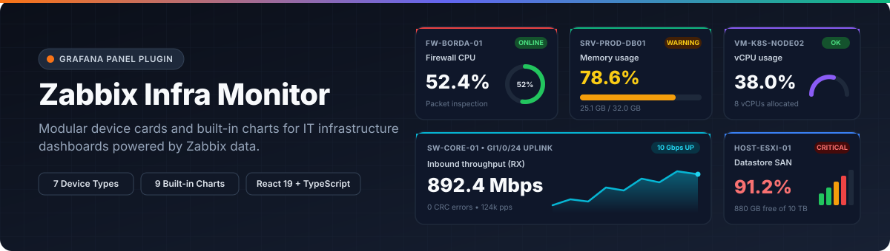
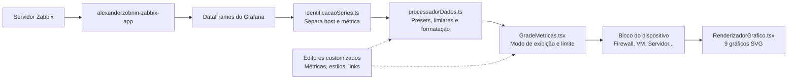

<p align="center">
  
</p>

<p align="center">
  <a href="https://github.com/guilhermeladislau/Dashboards-Grafana-React/actions/workflows/ci.yml"></a>
  = 13.2.0" />
  
  
  
  <a href="./LICENSE"></a>
</p>

<p align="center">
  <a href="./README.md">English</a> · <strong>Português (Brasil)</strong>
</p>

O **Zabbix Infra Monitor Panel** (`guilhermeladislau-zabbixmonitor-panel`) é um plugin de painel para o Grafana desenvolvido em React e TypeScript para monitorar infraestrutura de TI a partir de dados coletados pelo Zabbix (`alexanderzobnin-zabbix-app`). Em vez de criar um painel separado de stat, gauge ou série temporal para cada item, você seleciona o perfil do dispositivo (Firewall, VM, Host/Hipervisor, Servidor, Proxy, Access Point ou Porta de Rede) e o painel agrupa as métricas por host, aplica pré-configurações de unidade e limiares e renderiza gráficos SVG integrados em cada card.

## Principais recursos

- **7 perfis de dispositivo** com unidade padrão, tipo de gráfico, ícone e limiares de atenção/crítico já calibrados.
- **9 variações de gráfico SVG** integradas: barra horizontal, círculo/gauge 360°, arco/semi-gauge 180°, anel/donut, torre vertical graduada, área com gradiente, linha contínua, medidor bullet e termômetro vertical.
- **3 modos de organização dos cards**:
  - `individual`: 1 card por dispositivo, agrupando todas as métricas daquele host.
  - `consolidado`: todos os dispositivos e métricas reunidos em um único card (ou agrupados por métrica / por dispositivo).
  - `metricas_separadas`: 1 card isolado para cada métrica na grade responsiva.
- **Identificação de séries pensada para o Zabbix**: separa o nome do host e o nome da métrica a partir de labels (`host`, `hostname`, `device`, `instance`, `item`) ou dos padrões de nomenclatura do Zabbix (`HOST: Item`, `HOST - Item`), mantendo várias métricas do mesmo componente (como `CPU: Uso de CPU` e `CPU: Número de núcleos`) dentro do mesmo card.
- **Sobrescritas individuais**: ajuste gráfico, unidade, casas decimais, limiares, cores e links de navegação (`linkUrl`) por métrica ou por índice do bloco.

## Capturas de tela

Salve as capturas do seu ambiente em [`docs/images/`](./docs/images/) com os nomes abaixo (ou ajuste os caminhos):

| Visão consolidada de múltiplos dispositivos | Cards por dispositivo e variações de gráfico | Editor lateral de opções |
| :---: | :---: | :---: |
| *`docs/images/overview.png`* | *`docs/images/charts.png`* | *`docs/images/editor.png`* |

## Arquitetura e fluxo de dados



1. [`identificacaoSeries.ts`](./src/utilitarios/identificacaoSeries.ts) analisa o conjunto completo de `DataFrame`s retornado pela query para distinguir quando o prefixo antes de `: ` é o nome de um host compartilhado entre itens ou parte do nome da métrica.
2. [`processadorDados.ts`](./src/utilitarios/processadorDados.ts) cruza cada série com o catálogo do dispositivo ativo em [`preconfiguracoesDispositivos.ts`](./src/utilitarios/preconfiguracoesDispositivos.ts), avalia limiares normais, invertidos ou fixos, formata os valores (`bps`, `bytes`, `%`, `ms`, `dBm`, `W`, `°C`, `uptime`, `status`) e aplica sobrescritas individuais.
3. [`GradeMetricas.tsx`](./src/components/grade/GradeMetricas.tsx) organiza os itens conforme o `cardDisplayMode` e delega a renderização para [`BlocoConsolidadoDispositivo.tsx`](./src/components/dispositivos/BlocoConsolidadoDispositivo.tsx) ou para o componente dedicado do dispositivo via [`SeletorBlocoDispositivo.tsx`](./src/components/dispositivos/SeletorBlocoDispositivo.tsx).

## Dispositivos e métricas pré-configuradas

| Perfil (`deviceType`) | Cor de destaque | Métricas no catálogo (`AnyDeviceMetricType`) |
| :--- | :--- | :--- |
| `firewall` | `#ef4444` | Status (`fw_status`), CPU (`fw_cpu`), Memória (`fw_memoria`), Sessões ativas (`fw_sessoes`), Tráfego WAN RX/TX (`fw_trafego_wan_in` / `out`), Status VPN (`fw_vpn_status`), Ameaças bloqueadas pelo IPS (`fw_ameacas_bloqueadas`), Uptime (`fw_uptime`) |
| `vm` | `#8b5cf6` | Estado da VM (`vm_estado`), Uso de vCPU (`vm_cpu_uso`), CPU Ready (`vm_cpu_ready`), Memória RAM (`vm_memoria_uso`), Disco usado/livre (`vm_disco_usado` / `livre`), IOPS de disco (`vm_iops`), Snapshots ativos (`vm_snapshots`), Tráfego vNIC (`vm_rede`), Uptime (`vm_uptime`) |
| `proxy` | `#06b6d4` | Status do serviço (`proxy_status`), Requisições/s (`proxy_requisicoes_seg`), Taxa de Cache Hit (`proxy_cache_hit`, limiar invertido), Latência HTTP (`proxy_latencia`), Conexões ativas (`proxy_conexoes_ativas`), Consumo de banda (`proxy_banda`), CPU (`proxy_cpu`), Memória (`proxy_memoria`), Erros HTTP 4xx/5xx (`proxy_erros_http`) |
| `host` | `#3b82f6` | Status do host (`host_status`), Saúde do hardware (`host_saude`), CPU física (`host_cpu_uso`), Memória física (`host_memoria_uso`), Datastore usado/livre (`host_datastore_uso` / `livre`), VMs ativas (`host_vms_ativas`), Temperatura (`host_temperatura`), Consumo elétrico (`host_energia`), Uptime (`host_uptime`) |
| `servidor` | `#10b981` | Ping ICMP (`srv_status_ping`), Status do Zabbix Agent (`srv_status_agent`), CPU (`srv_cpu_uso`), Fila de CPU (`srv_cpu_fila`), Memória usada/livre (`srv_memoria_uso` / `livre`), Disco usado/livre/latência (`srv_disco_uso` / `livre` / `latencia`), Tráfego de rede (`srv_rede_trafego`), Serviços parados (`srv_servicos_parados`), Uptime (`srv_uptime`) |
| `access_point` | `#f59e0b` | Status do AP (`ap_status`), Clientes conectados (`ap_clientes`), Qualidade do sinal % (`ap_sinal_qualidade`), Potência RSSI em dBm (`ap_sinal_dbm`), Interferência do canal (`ap_interferencia`), Tráfego Wi-Fi RX/TX (`ap_trafego_in` / `out`), CPU (`ap_cpu`), Uptime (`ap_uptime`) |
| `porta_rede` | `#ec4899` | Status da porta UP/DOWN (`porta_status`), Tráfego RX/TX (`porta_trafego_in` / `out`), Utilização da banda % (`porta_utilizacao_pct`), Pacotes/s (`porta_pacotes_seg`), Erros CRC/descartes (`porta_erros`), Velocidade negociada (`porta_velocidade`), Consumo PoE em Watts (`porta_poe_watts`) |

Quando `deviceType` está em `auto`, o painel identifica a categoria pelos nomes das séries retornadas. Séries que não correspondem a um preset continuam sendo exibidas com seu próprio nome e unidade.

## Tipos de gráfico integrados

| Chave | Visualização | Componente | Uso recomendado |
| :--- | :--- | :--- | :--- |
| `barra` | Barra de progresso horizontal | [`GraficoBarra.tsx`](./src/components/graficos/GraficoBarra.tsx) | Memória, disco, ocupação de banda |
| `circulo` | Gauge circular 360° | [`GraficoCirculo.tsx`](./src/components/graficos/GraficoCirculo.tsx) | Uso de CPU |
| `arco` | Semi-gauge 180° | [`GraficoArco.tsx`](./src/components/graficos/GraficoArco.tsx) | vCPU, percentuais de carga |
| `anel` | Anel / donut | [`GraficoAnel.tsx`](./src/components/graficos/GraficoAnel.tsx) | Taxa de cache hit, qualidade de sinal Wi-Fi |
| `torre` | Colunas verticais graduadas | [`GraficoTorre.tsx`](./src/components/graficos/GraficoTorre.tsx) | Ocupação de storage, contadores IPS, erros CRC |
| `area` | Sparkline de área com gradiente | [`GraficoArea.tsx`](./src/components/graficos/GraficoArea.tsx) | Tráfego de rede, sessões ativas, req/s |
| `linha` | Sparkline em linha contínua | [`GraficoLinha.tsx`](./src/components/graficos/GraficoLinha.tsx) | Latência de disco, tempo de resposta ping |
| `bullet` | Medidor bullet horizontal | [`GraficoBullet.tsx`](./src/components/graficos/GraficoBullet.tsx) | Contenção de CPU Ready, lotação de clientes |
| `termometro` | Termômetro vertical | [`GraficoTermometro.tsx`](./src/components/graficos/GraficoTermometro.tsx) | Temperatura de chassi e processador (°C / °F) |
| `nenhum` | Somente valor e tag de status | (sem gráfico) | Estados binários (Ping, Agent, Link UP/DOWN, Uptime) |

## Instalação

### Opção 1: Docker Compose (recomendado para avaliação local)

Pré-requisitos: Node.js `>= 22`, npm e Docker.

```bash
git clone https://github.com/guilhermeladislau/Dashboards-Grafana-React.git
cd Dashboards-Grafana-React
npm install
npm run build
npm run server
```

O Grafana sobe em `http://localhost:3000` com acesso anônimo de administrador habilitado e a pasta `dist/` montada em `/var/lib/grafana/plugins/guilhermeladislau-zabbixmonitor-panel`.

### Opção 2: Servidor Grafana existente (Linux / WSL)

1. Gere o pacote de produção:
   ```bash
   npm install
   npm run build
   ```
2. Copie o conteúdo de `dist/` para o diretório de plugins do seu Grafana:
   ```bash
   sudo mkdir -p /var/lib/grafana/plugins/guilhermeladislau-zabbixmonitor-panel
   sudo cp -r dist/* /var/lib/grafana/plugins/guilhermeladislau-zabbixmonitor-panel/
   sudo chown -R grafana:grafana /var/lib/grafana/plugins/guilhermeladislau-zabbixmonitor-panel
   ```
   Ou execute o script auxiliar:
   ```bash
   sudo bash ./install-plugin.sh
   ```
3. Como o plugin não possui assinatura digital para uso privado/local, libere o ID em `/etc/grafana/grafana.ini`:
   ```ini
   [plugins]
   allow_loading_unsigned_plugins = guilhermeladislau-zabbixmonitor-panel
   ```
4. Reinicie o serviço do Grafana:
   ```bash
   sudo systemctl restart grafana-server
   ```

## Como usar

1. No Grafana, abra um dashboard, clique em **Add > Visualization** e escolha **Zabbix Infra Monitor Panel**.
2. Configure uma ou mais queries usando o datasource do Zabbix (`alexanderzobnin-zabbix-app`). Você pode consultar várias métricas de um mesmo host ou uma métrica em vários hosts (usando regex como `/.*/` no campo Host).
3. Na barra lateral direita, em **Dispositivo e Monitoramento**:
   - **Tipo de Dispositivo**: escolha o perfil do equipamento ou mantenha `Automático`.
   - **Modo de Exibição do Card**: alterne entre `1 Card por Dispositivo`, `Agrupar Todos em 1 Único Card` ou `1 Card por Métrica`.
   - **Quais Métricas Monitorar**: deixe desmarcado para exibir todas as séries retornadas pela query ou marque métricas específicas para filtrar o card.
   - **Estilizar Métricas Individualmente**: altere gráfico, unidade, limiares ou cores de cada métrica detectada.
   - **Configuração & Links por Bloco**: defina URLs de navegação (`linkUrl`) por índice do bloco ou nome de host.

## Demonstração sem servidor Zabbix

A pasta [`JSON-TESTE/`](./JSON-TESTE/) traz um dashboard completo configurado com o datasource nativo `grafana-testdata` do Grafana:

1. No Grafana, acesse **Dashboards > New > Import**.
2. Envie o arquivo [`JSON-TESTE/dashboard-monitoramento-ti-testdata.json`](./JSON-TESTE/dashboard-monitoramento-ti-testdata.json).
3. Selecione a sua instância `grafana-testdata` e clique em **Import**.

Consulte [`JSON-TESTE/README.md`](./JSON-TESTE/README.md) para a listagem de todos os cenários cobertos no dashboard de demonstração.

## Scripts de desenvolvimento

| Comando | Descrição |
| :--- | :--- |
| `npm run dev` | Executa o Webpack em modo watch para desenvolvimento |
| `npm run build` | Gera o pacote de produção em `./dist` |
| `npm run typecheck` | Valida a tipagem TypeScript (`tsc --noEmit`) |
| `npm run test:ci` | Executa os testes unitários com Jest (`processadorDados.test.ts`) |
| `npm run lint` | Executa o ESLint no projeto |
| `npm run lint:fix` | Corrige problemas de lint e formata o código com Prettier |
| `npm run server` | Sobe o container Docker do Grafana com o plugin montado |
| `npm run e2e` | Executa os testes E2E com Playwright contra o container em execução |
| `npm run deploy` | Executa `atualizar-grafana.sh` (typecheck + build + reload do container) |

## Estrutura de pastas

```text
.
├── docs/
│   ├── banner.svg                          # Ilustração de topo do repositório
│   └── images/                             # Capturas de tela do painel
├── JSON-TESTE/
│   ├── dashboard-monitoramento-ti-testdata.json
│   ├── monitoramento-ficticio-plugin.json
│   └── README.md
├── provisioning/                           # Dashboards e datasources provisionados no Docker
├── src/
│   ├── components/
│   │   ├── bloco/                          # Cabeçalho, valor, barra, sparkline e tag de status
│   │   ├── dispositivos/                   # Blocos por dispositivo + BlocoConsolidadoDispositivo
│   │   ├── editor/                         # Editores customizados e gavetas retráteis
│   │   ├── grade/                          # CSS Grid responsivo e limite de exibição
│   │   ├── graficos/                       # 9 componentes SVG + RenderizadorGrafico
│   │   └── painel/                         # Container principal, título e estado vazio
│   ├── estilos/                            # Cores do tema, tipografia e dimensões dos blocos
│   ├── utilitarios/
│   │   ├── avaliadores.ts                  # Avaliação de limiares (normal, invertido, fixo)
│   │   ├── formatadores.ts                 # Formatadores de unidade (bytes, bps, ms, uptime, status)
│   │   ├── identificacaoSeries.ts          # Parser de host e métrica para séries Zabbix
│   │   ├── preconfiguracoesDispositivos.ts # Catálogo dos 7 dispositivos e presets de métricas
│   │   ├── processadorDados.ts             # Pipeline DataFrame -> MetricBlockItem
│   │   ├── processadorDados.test.ts        # Testes unitários de identificação e processamento
│   │   └── resolucaoOpcoes.ts              # Mescla opções das gavetas com campos legados
│   ├── module.ts                           # Registro do PanelPlugin e opções do editor
│   ├── plugin.json                         # Manifesto do plugin (id: guilhermeladislau-zabbixmonitor-panel)
│   └── types.ts                            # Interfaces TypeScript e tipos das opções
├── tests/
│   └── panel.spec.ts                       # Testes E2E com Playwright
├── atualizar-grafana.sh                    # Script de build e atualização do container
└── install-plugin.sh                       # Script de instalação em servidor Linux / WSL
```

## Stack técnica

- **React 19** e **TypeScript 5.9**
- **Grafana Plugin SDK** (`@grafana/data`, `@grafana/ui`, `@grafana/runtime`, `@grafana/schema` `13.2.4`)
- **Emotion CSS** (`@emotion/css`) para estilização dinâmica com escopo
- **Webpack 5** + **SWC** para compilação rápida
- **Jest** (testes unitários) e **Playwright** (`@grafana/plugin-e2e`)

## Próximos passos

- Adicionar testes de renderização para os 9 componentes de gráfico SVG.
- Suportar interpolação de variáveis do Grafana (`${__field.labels.host}`) nos links por bloco.
- Criar perfis dedicados para bancos de dados (PostgreSQL / MySQL / MSSQL) e nobreaks (UPS).
- Assinar e publicar o plugin no catálogo oficial do Grafana.

## Licença e autor

Distribuído sob a licença [Apache 2.0](./LICENSE).

Desenvolvido por **Guilherme Ladislau** ([github.com/guilhermeladislau](https://github.com/guilhermeladislau)).
